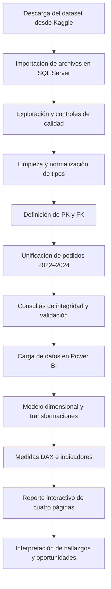

# 🌸 Lotus Retail | Análisis de datos con SQL y Power BI

  

## 1. Presentación del proyecto

**Lotus Retail** es un proyecto de análisis de datos y *Business Intelligence* que recorre el proceso desde la preparación de una base relacional en **SQL Server** hasta el desarrollo de un **reporte interactivo en Power BI**.

El propósito es convertir datos de operaciones minoristas en indicadores claros sobre **ventas, pedidos, rentabilidad, sucursales, empleados y productos**, facilitando la exploración de resultados y la identificación de oportunidades comerciales. El proyecto utiliza datos **sintéticos de práctica**: sus resultados no deben interpretarse como cifras reales de una empresa.

**Herramientas utilizadas:** SQL Server y T-SQL (validación, limpieza y relaciones), Power BI Desktop, Power Query (transformaciones de presentación) y DAX (medidas e indicadores).

## 2. Origen y características de la base de datos

**Fuente:** [Lotus Retail Dataset – Power BI (Multi tables), de Abdelrahman Mahmoud, en Kaggle](https://www.kaggle.com/datasets/abdelrahmanmahmoud22/lotus-group-retail-star-schema-bi).

El conjunto de datos está diseñado para practicar análisis retail y modelado dimensional. Sus características principales son:

- **Período:** 2022–2024.
- **Formato:** archivos CSV relacionados entre sí.
- **Estructura:** múltiples tablas de **dimensiones** y **hechos**, aptas para construir un modelo analítico tipo estrella.
- **Contenido:** clientes, fechas, empleados, productos, sucursales, órdenes, detalle de órdenes y devoluciones.
- **Variables de negocio:** importes de ventas, costos, precios, unidades, categorías y subcategorías, medios de pago, estados de pedidos y devoluciones.
- **Calidad de datos:** contiene situaciones útiles para practicar depuración, como duplicados e inconsistencias de formato y tipos de datos.

### Tablas originales utilizadas

| Tipo | Tabla | Información principal |
|---|---|---|
| Dimensión | `dim_customers` | Identificación y atributos de clientes |
| Dimensión | `dim_date` | Calendario y atributos temporales |
| Dimensión | `dim_employees` | Empleados y funciones |
| Dimensión | `dim_products` | Productos, categorías, precios y costos |
| Dimensión | `dim_stores` | Sucursales y ubicación |
| Hechos | `fact_orders_2022_2023` | Cabeceras de pedidos de 2022 y 2023 |
| Hechos | `fact_orders_2024` | Cabeceras de pedidos de 2024 |
| Hechos | `fact_order_details` | Detalle de artículos y valores por pedido |
| Hechos | `fact_returns` | Registro de devoluciones |

> **Transformación importante:** las dos tablas de órdenes por período se unificaron en SQL mediante `UNION ALL` en una nueva tabla `fact_orders`, utilizada como base común para el análisis de pedidos.

## 3. Objetivos del análisis

**Objetivo general:** construir una solución de análisis de datos que permita evaluar el desempeño comercial y operativo de Lotus Retail a partir de sus transacciones históricas.

**Objetivos específicos:**

1. Preparar y validar los datos para obtener un modelo consistente y relacionable.
2. Analizar la facturación y su evolución mensual y anual.
3. Identificar productos, categorías y sucursales de mayor participación en las ventas.
4. Evaluar indicadores comerciales como ticket promedio, márgenes, costos y ganancias.
5. Examinar el desempeño de los empleados y la distribución de pedidos completados, cancelados y devueltos.
6. Facilitar el análisis por filtros de fecha, sucursal o producto mediante un dashboard interactivo.

## 4. Línea de tiempo / flujo de procesos



### Etapa inicial — Obtención e inspección

Se descargaron los archivos del dataset desde Kaggle y se creó la base `LotusRetail` en SQL Server. Se exploraron las tablas con consultas a `INFORMATION_SCHEMA.COLUMNS` para revisar **nombres de columnas, tipos de datos, nulabilidad y precisión**, y se verificó la cantidad de registros mediante `COUNT(*)`.

### Etapa de desarrollo — Preparación de datos con SQL

El archivo `SQL-LotusRetail.sql` documenta operaciones de validación, limpieza y estructuración:

- **Duplicados:** búsquedas mediante `GROUP BY` y `HAVING COUNT(*) > 1`; eliminación de duplicados de clientes con una CTE y `ROW_NUMBER()`.
- **Corrección de tipos:** cambios con `ALTER TABLE` a `NVARCHAR` y `DECIMAL(18,2)` para campos de texto e importes.
- **Homogeneización:** conversión de los trimestres de la dimensión de fechas a etiquetas `Q1`, `Q2`, `Q3` y `Q4`.
- **Integridad referencial:** creación de **claves primarias (PK)** y **claves foráneas (FK)** entre dimensiones, órdenes, detalles y devoluciones.
- **Validaciones relacionales:** detección de productos no encontrados en el catálogo, búsqueda de órdenes repetidas entre años y comprobación de devoluciones sin una orden asociada.
- **Integración temporal:** consolidación de `fact_orders_2022_2023` y `fact_orders_2024` en `fact_orders` con `UNION ALL`; conteo de pedidos por año con `YEAR(order_date)`.

**Ejemplo representativo de la unificación:**

```sql
SELECT *
INTO fact_orders
FROM (
    SELECT * FROM fact_orders_2022_2023
    UNION ALL
    SELECT * FROM fact_orders_2024
) AS orders;
```

> El script entregado registra principalmente consultas de **preparación e integridad**, más que un catálogo de consultas de resultados comerciales agregados. Los análisis de rendimiento comercial se desarrollan principalmente en el reporte de Power BI.

### Etapa de desarrollo — Modelo y visualización en Power BI

Después de la preparación en SQL, los datos se incorporaron a Power BI. Se trabajó con un enfoque de **modelado dimensional**, relacionando tablas de hechos (órdenes, detalles y devoluciones) con dimensiones de fecha, clientes, productos, empleados y sucursales. La estructura incluye diferentes niveles de detalle transaccional, por lo que es importante respetar las relaciones y la granularidad de cada indicador.

Se utilizaron **medidas DAX**, segmentadores, tarjetas KPI, gráficos de líneas y barras, tablas, y navegación entre páginas. La presentación adopta una identidad visual rosa y violeta asociada a Lotus Retail.

### Etapa final — Reporte interactivo

El archivo `ProyectoLotus.pbix` contiene **cuatro páginas**:

| Página | Contenido |
|---|---|
| **Página principal** | Ventas acumuladas, clientes, empleados, evolución mensual, producto y empleado destacado, resumen por sucursal y subcategorías |
| **Métricas** | Ticket promedio, margen de ganancias, ganancia por pedido, evolución de indicadores y comparación mensual |
| **Detalles de sucursal y empleados** | Resultados por sucursal, desempeño de empleados, unidades vendidas, pedidos completados, cancelados y devueltos |
| **Detalles de productos** | Precio y costo unitario, márgenes, ganancia potencial, unidades vendidas, tendencias y cumplimiento de objetivos |

## 5. Indicadores destacados del dashboard

En la vista general compartida del reporte se observan los siguientes valores (sujetos al contexto de filtros):

| Indicador | Resultado mostrado |
|---|---:|
| Importe total de ventas efectivas | **$396.527.140,00** |
| Clientes totales | **2.945** |
| Empleados | **216** |
| Producto destacado | **Polo Shirt 2068** |
| Empleado destacado | **Suzy Amin** |

Estos valores describen la **versión visualizada del dashboard** y no necesariamente se mantienen iguales al cambiar filtros o actualizar los datos.

## 6. Hallazgos y oportunidades identificadas

### Hallazgos

- **Rentabilidad por producto:** El dashboard focaliza el seguimiento del desempeño, precio y disponibilidad de los productos. El análisis de precios de venta, costos y márgenes permite identificar productos con diferentes niveles de contribución económica.
- **Relación entre volumen y margen:** Los productos con mayor cantidad de unidades vendidas no necesariamente son los que generan mayores márgenes, por lo que resulta relevante evaluar ambas variables conjuntamente.
- **Desempeño desigual entre sucursales:** La comparación de ventas, empleados y clientes entre establecimientos permite identificar diferencias operativas y oportunidades para profundizar el análisis de productividad.
- **Cumplimiento de objetivos de ventas:** El seguimiento de metas comerciales por producto permite identificar desviaciones entre los resultados esperados y los efectivamente alcanzados.
- **Salarios y productividad:** La comparación entre remuneraciones y resultados comerciales permite explorar la relación entre los costos salariales y el rendimiento de los empleados, sin asumir necesariamente una relación causal.
- **Variabilidad mensual:** El seguimiento de las variaciones porcentuales permite detectar períodos de crecimiento, estabilidad o contracción de la actividad comercial.
- **Contribución por subcategoría:** el reporte permite distinguir subcategorías con mayor volumen de unidades, información útil para priorizar el análisis comercial.
- **Tendencias de ventas observadas a lo largo del tiempo:** El análisis de la evolución temporal de las ventas permite identificar patrones de crecimiento, períodos de fluctuación y posibles cambios en el comportamiento comercial. En términos generales, se observa una tendencia levemente positiva, aunque con variaciones entre períodos, lo que sugiere un crecimiento moderado de la actividad comercial.

### Oportunidades de mejora

1. **Reducir cancelaciones y devoluciones:** identificar sucursales, productos o períodos con mayores tasas, y explorar sus posibles causas.
2. **Optimizar el surtido:** contrastar productos y subcategorías más vendidos con sus márgenes, costos y ganancias; un mayor volumen no implica necesariamente mayor rentabilidad.
3. **Comparar sucursales con indicadores normalizados:** además de ventas totales, evaluar ventas por empleado, ticket promedio y margen, evitando conclusiones basadas únicamente en el tamaño de cada local.
4. **Monitorear objetivos de venta:** utilizar el seguimiento mensual para detectar desvíos y priorizar acciones comerciales.
5. **Profundizar el análisis temporal:** comparar períodos equivalentes de distintos años para identificar tendencias sostenidas y posibles patrones estacionales.

> **Alcance de las conclusiones:** los hallazgos anteriores se basan en los indicadores y visualizaciones disponibles, no en pruebas de causalidad. Las oportunidades son líneas de análisis y acción sugeridas, no resultados experimentales comprobados.

## 7. Archivos del proyecto

```text
Lotus-Retail/
├── README.md
├── SQL-LotusRetail.sql
├── ProyectoLotus.pbix
│
└── images/
    └── dashboard-principal.png
```

**Para explorar el proyecto:** revisar el archivo SQL en SQL Server Management Studio y abrir `ProyectoLotus.pbix` con Power BI Desktop. Para actualizar datos desde otra computadora puede ser necesario reconfigurar la conexión al servidor SQL y sus credenciales.

## 8. Fuente y créditos

- **Dataset original:** [Lotus Retail Dataset – Power BI (Multi tables) — Kaggle](https://www.kaggle.com/datasets/abdelrahmanmahmoud22/lotus-group-retail-star-schema-bi).
- **Desarrollo del proyecto:** preparación y validación de datos en SQL, construcción del modelo analítico, medidas y dashboard en Power BI.

## 9. Uso de inteligencia artificial como herramienta de apoyo

Durante el desarrollo del proyecto se utilizó inteligencia artificial de manera complementaria, principalmente como herramienta de consulta, asistencia técnica y verificación.

Su utilización estuvo orientada a facilitar la comprensión de funciones, contrastar enfoques de cálculo y validar posibles soluciones.

El análisis de los datos, la construcción del modelo, la selección de indicadores, el diseño de las visualizaciones y la interpretación de los resultados se desarrollaron como parte del trabajo práctico y analítico del proyecto.

La inteligencia artificial se empleó como **recurso de apoyo al proceso de desarrollo**, sin sustituir el criterio analítico ni la toma de decisiones sobre la implementación final.


---

*Proyecto de portafolio orientado a SQL, modelado dimensional, análisis de datos y Business Intelligence.*
